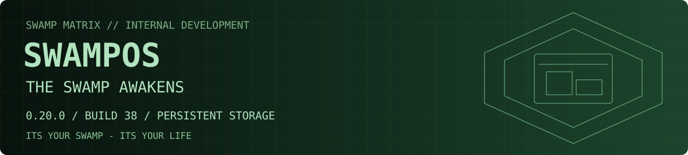
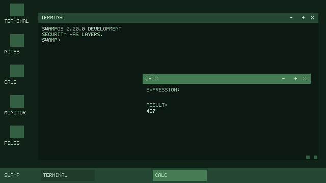
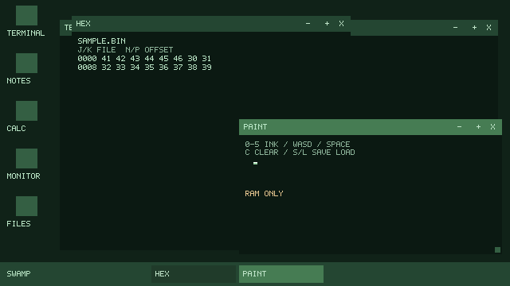
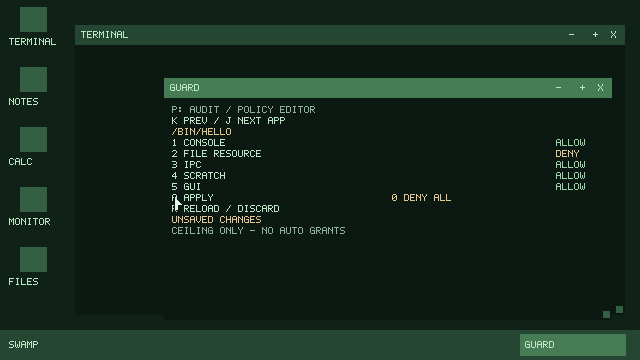
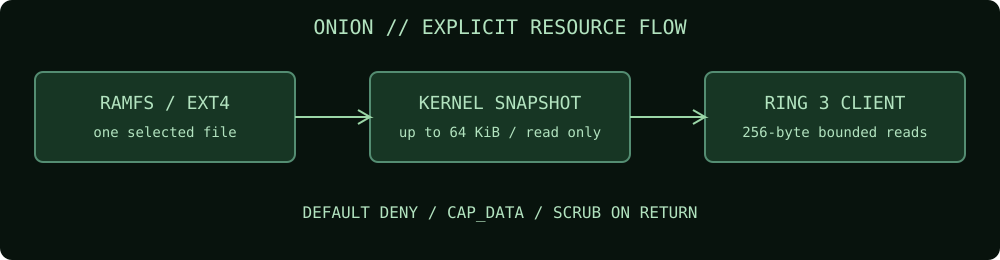
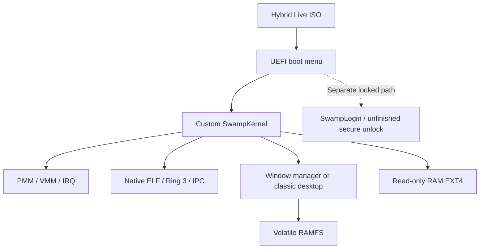

<div align="center">



[](docs/AWAKENS.md)
[](RELEASE.md)
[](docs/ABI.md)
[](docs/LIVE.md)
[](TEST-REPORT.md)
[](docs/GIT-LFS.md)

**Security has layers. The swamp awakens.**

[Quick start](#quick-start) · [Desktop](#swampgui) · [Storage](#swampfs) · [Architecture](#architecture) · [Features](FEATURES.md) · [Missing](MISSING.md) · [Tests](TEST-REPORT.md)

</div>

## `> whoami`

SwampOS is an independent bare-metal x86_64 operating system project, not a Linux distribution. Farkuad 0.13.1 is the user-confirmed VirtualBox checkpoint. Awakens develops the target 0.20.0 through cumulative internal builds, not new public version tags for each feature.

| x86_64 | Dynamic (42.90 MiB at Build 38) | 10 | 64 × 8 KiB | 12 |
| :---: | :---: | :---: | :---: | :---: |
| Architecture | Live ISO | Windowed tools | Volatile files | Native syscalls |

> [!IMPORTANT]
> Build 36 booted from optical and USB media in QEMU/OVMF. Pointer movement, drag and resize were verified from guest framebuffer pixels. VirtualBox and physical display validation remain open. The unsigned Live desktop runs ten kernel-trusted tools and keeps its default workspace in RAM.

## Build 38 revision 1 · Persistent storage

The prebuilt image targets baseline x86-64. Revision 1 also updates the legacy VirtIO queue and the UEFI test profiles. From GitHub, use the two `r1` ZIPs in [downloads/build38](https://github.com/norkxxx/SwampOS/tree/build/38-persistent-storage/downloads/build38).

SwampKernel can preserve a note across guest shutdowns on an emulated AHCI disk or NVMe namespace. Mount the disposable volume explicitly, then use the same shell path with either controller. The Live root stays in RAM.

```sh
make live-storage-desktop                         # Linux/QEMU GTK, NVMe
make live-storage-desktop STORAGE_CONTROLLER=ahci # independent AHCI image
make live-storage-runtime                         # headless persistence and recovery tests
```

In SwampOS, enter `persist-mount`, `write /persist/note hello swamp`, then `cat /persist/note`. Close QEMU, repeat the same launch command, mount again and read the file. Each interactive profile keeps its own 4 MiB image under `build/`. [Storage format and limits](docs/PERSISTENCE.md)

## Build 37 · USB keyboard and mouse

The Live desktop accepts a USB keyboard and a relative USB mouse on one QEMU xHCI controller. SwampKernel enumerates both root ports after exiting UEFI, selects boot protocol and polls both interrupt endpoints. This profile disables i8042. Both devices use the same desktop input handlers as PS/2.

```sh
make live-usb-desktop        # Q35, OVMF, VT-d, USB keyboard + mouse, local GTK window
make live-usb-input-runtime  # six automated guest profiles
```

On Linux, the interactive command needs QEMU with GTK and an active graphical session. The project installer includes the Debian/Ubuntu GUI package. In VirtualBox, keep the EFI, VBoxSVGA and PS/2 settings from the previous checkpoint. See [USB input and DMA isolation](docs/USB-INPUT.md) for the supported hardware profile and recovery commands.

## Build 36 · Desktop rendering

Build 36 keeps a 640 × 360 scene in 900 KiB of kernel memory. Both desktop modes draw there before copying finished pixels to the UEFI framebuffer. Moving the pointer over a static desktop updates the old and new 8 × 13 cursor areas. Dragging a window repaints its old and new bounds in stacking order. Presentation runs at most once every two PIT ticks (about 50 Hz). The input loop processes button and key transitions in order between presentations.

The USB and optical guest tests compare the captured desktop with the expected cursor overlay, drag Notes and resize it. See the evidence and reproduction commands in [TEST-REPORT.md](TEST-REPORT.md).

## Quick start

Extract the full checkpoint archive. To use the prebuilt hybrid UEFI ISO, select `build/Farkuad-Live.iso` in VirtualBox or a raw USB writer. The historical filename is preserved for build-script compatibility. The optical FAT16 and USB FAT32 volumes are now sized from the EFI payload; see `build/Farkuad-Live.iso.report` and [the image layout](docs/LIVE-IMAGE-LAYOUT.md).

```sh
(cd build && sha256sum -c Farkuad-Live.iso.sha256)
# Linux / Ubuntu WSL2, build from source:
./install.sh
bash scripts/build-live.sh
make test
make checksums
```

VirtualBox: x64 EFI enabled, 1 CPU, 512–1024 MiB RAM, PS/2 Mouse (not USB Tablet), VBoxSVGA, no 3D acceleration, no network. Use a disposable VM. For physical USB use a raw/DD writer; **flashing erases the selected USB drive**. The guarded Linux script is `scripts/flash-live.sh`. Read [Live guide](docs/LIVE.md) before writing a drive. Do not change Secure Boot on a production or managed PC.

```sh
make live-runtime          # QEMU/OVMF USB boot
make live-optical-runtime  # QEMU/OVMF optical boot
```

## Boot menu

```text
              _______________
         ___ /               \ ___
        (___)  _          _   (___)
            | (o)        (o) |
            |       __       |
            |    ._______.   |
             \     -----    /
              '------------'

         SWAMPOS / AWAKENS DEV 38 R1
       ITS YOUR SWAMP - ITS YOUR LIFE

     > 1. Live Desktop (keyboard + PS/2 mouse)
       2. Classic Desktop (keyboard only)
       3. Serial recovery console (COM1)
       4. Return to firmware

   Autoboot in 10 seconds
```

Native UEFI menu, not GRUB. Arrow keys, Enter, digits 1–4, Esc. The 10-second delay is based on firmware stalls; rendering can add overhead.

## SwampGUI



*Actual output of the C renderer in the host harness, with illustrative content; not a guest screenshot.*

The first boot option enables overlapping windows, launcher, desktop icons, z-order, focus, taskbar, mouse dragging/resizing and minimize/maximize/restore/close. Tab opens the next tool, Esc opens Terminal. The second option keeps Farkuad's original tab interface. The trusted client views are bounded; no GPU acceleration or clipboard yet. Build 06 adds one-shot native GUI capture; Build 14 adds a single resumable native GUI session.

| Tool | Available behavior |
|---|---|
| Terminal | Native kernel shell, scrollback and 16-entry command history |
| Notes | 512-character editor; Save/Load to volatile notes.txt |
| Calculator | Checked signed integer arithmetic |
| Monitor | Kernel timer and physical frame counts |
| Files | Embedded EXT4 text, binary and /bin previews |

| RAM Files | Browse the volatile file namespace (J/K) |
| Hex | Inspect actual RAM file bytes (J/K file, N/P offset) |
| Paint | 24×12 pixel canvas, six colors; Shift+S/L saves/loads RAM file |
| Settings | Three volatile desktop background palettes |
| Guard | Read-only audit snapshot, J/K scroll |



*Build 04 C renderer host output; not a guest screenshot.* The Swamp launcher has two columns. The taskbar displays the focused tool's group; use the launcher or Tab to switch groups. The five original tools remain available in the classic mode. These new tools are kernel-trusted, not sandboxed GUI clients.

## Build 32 — Runtime xHCI PCI inventory

The kernel now exposes `xhci`, a read-only inspection command for PCI functions with class `0C:03:30`. It reports BDF, vendor/device IDs, BAR0 type/address, Memory Space Enable, Bus Master Enable and I/O Space Enable. BARs are decoded without sizing writes. The command does not enable PCI decoding, bus mastering, MMIO or DMA. A zero BAR is reported as unassigned; malformed BAR types and inconsistent class/header data are rejected. The Live boot menu and kernel banner now identify DEV 32.

Build 31's dynamic ISO sizing remains in place: the El Torito FAT16 and USB FAT32 volumes are sized from the EFI payload, with FAT16/El Torito and FAT32 minimum-cluster limits enforced. The build emits `Farkuad-Live.iso.report`; host tests prove that a larger EFI payload produces a larger ISO. Current Build 32 ISO size is recorded in `build/Farkuad-Live.iso.report`.

## Build 15 — Volume-scoped SwampGuard identities

SwampGuard profiles use the full EXT4 UUID plus inode number. Equal inode numbers on different UUID volumes no longer share ceilings; remounting the same UUID retains its profile during the current session. Zero UUIDs are rejected. Cloned volumes with the same UUID intentionally share policy. Profiles remain volatile. See [volume identity](docs/GUARD-IDENTITY.md).

## Build 14 — Resumable native GUI client

In windowed Paint, press **Shift+G** to start the 24-frame native ELF animation, or **Shift+X** to cancel. The kernel saves a trusted register frame when the client yields or reaches two PIT ticks, restores the kernel CR3 and returns to the desktop. Each subsequent desktop poll at five-tick intervals resumes it. Closing Paint, remounting the volume or changing any SwampGuard policy stops the session. A 100-slice budget bounds the client. Only CAP_GUI is granted; no raw framebuffer, filesystem or device access. Other native ELF launches are rejected until the session ends. `gui-async-test` checks the same resume path in a guest, while `gui-demo` preserves synchronous capture. See [resumable GUI](docs/GUI-ASYNC.md). The Build 36 USB and optical guest runs both recorded `GUI_ASYNC_TEST_OK`.

## Build 13 — SwampGuard graphical policy editor



*Actual C renderer host output; not a guest screenshot.* Open GUARD from the Swamp menu and press P. Select one of six bundled native ELF applications, stage changes using 1–5, and press A to apply. Mouse controls, explicit commit, reload, deny-all and stale-revision rejection share the trusted shell policy backend. Profiles are still volatile ceilings, not automatic grants. See [editor controls](docs/GUARD-EDITOR.md).

## Build 12 — SwampGuard permission ceilings

Set a volatile per-volume/per-inode capability ceiling for a native ELF using `guard-set /bin/resource-scan 3`. All native storage launch routes enforce it, including group and GUI capture. The ceiling restricts explicit grants without granting new rights. See [SwampGuard ceilings](docs/GUARD-CEILINGS.md).

## Build 11 — Full-size read-only application resources



Applications can now read a single explicitly granted file up to **64 KiB** (RAMFS itself limits files to 8 KiB), in chunks of at most 256 bytes. The kernel does not map the resource directly into the client. A separate native ELF utility reports the byte count and FNV-1a checksum; this checksum is diagnostic, not cryptographic.

```sh
run-resource-console /bin/resource-scan ext:/pattern.bin
ramwrite report.txt hello_swamp
run-resource-console /bin/resource-scan ram:report.txt
```

The 9,000-byte test file exercises reads across page boundaries. The previous short-resource demo, syscall numbering and permission defaults are preserved. See [Resource grants](docs/RESOURCE-GRANTS.md).

## Build 10 — Explicit application resource grants

```sh
ramwrite demo.txt Hello_SwampOS
run-resource-console /bin/integration-demo ram:demo.txt
run-resource-console /bin/integration-demo ext:/welcome.txt
```

`run-resource` grants only CAP_DATA; the `-console` variant additionally grants CAP_CONSOLE. At Build 10, a single selected regular file (at most 256 bytes; raised in Build 11) is copied into the existing per-run session. No file handles, filesystem access or permission changes from Ring 3 are provided. See [Resource grants](docs/RESOURCE-GRANTS.md).

## Build 09 — Read-only ATA transport

The existing secondary IDE laboratory backend now decodes ATA IDENTIFY, rejects unsupported logical sector sizes, and issues LBA28 or LBA48 PIO read commands as appropriate. `ata-info` reports sector count in the non-Live lab only. Live mode rejects physical ATA access both in the shell and the driver wrapper. AHCI/NVMe and physical USB transport remain unimplemented. See [ATA transport](docs/ATA-PIO.md).

## Build 08 — Expanded volatile filesystem

```sh
rammkdir docs
ramimport /welcome.txt docs/welcome.txt
ramappend docs/welcome.txt Hello_SwampOS
rammv docs archive
ramcat archive/welcome.txt
ramstat
```

The full directory move is validated before any mutation. Import reads the existing mounted EXT4 and never writes to the source device. Limits and tests: [RAMFS volume](docs/RAMFS-VOLUME.md).

## Build 07 — Hardware groundwork

`usb` enumerates PCI USB controller functions (UHCI, OHCI, EHCI, xHCI) without touching their MMIO or enabling bus mastering. `usbtest` exercises bounded configuration descriptor and boot keyboard/mouse codecs. `rtc` reads a stable legacy CMOS clock snapshot (two-digit year, unknown timezone). These are not a USB transport driver; physical USB HID is still unavailable. PS/2 remains the supported input path. See [Hardware groundwork](docs/USB-RTC.md).

## Build 06 — First native GUI client

`/bin/gui-demo` is a separately compiled ELF on the embedded EXT4 volume. The ordinary `run /bin/gui-demo` path must exit 13 because it has no GUI capability. The shell command `gui-demo` performs a capability-gated capture; in the Paint window originally used Shift+G for one-shot capture; Build 14 instead starts the resumable client. The new syscall copies exactly 128 palette indices into a kernel-owned staging buffer; user code receives no framebuffer pointer. See [Native GUI ABI](docs/GUI-CLIENT.md).

The original synchronous capture route is retained; Build 14 adds a separate resumable client, not a general compositor or window protocol. The Build 36 guest runs recorded `GUI_DEMO_OK` and `GUI_ASYNC_TEST_OK`.

## SwampFS

The embedded 8 MiB EXT4 remains read-only. Build 02 adds a separate volatile RAMFS namespace, not persistent EXT4 writes.

```text
swamp> ramwrite hello.txt hello swamp
swamp> ramcp hello.txt copy.txt
swamp> rammv copy.txt final.txt
swamp> ramls
swamp> ramcat final.txt
swamp> ramrm hello.txt
swamp> ramstat
```

64 files, up to 8,192 bytes each (512 KiB payload), 64 directory slots, restricted canonical relative paths (95 bytes maximum, eight components, each up to 31 bytes), append, bounded range reads and preflight-validated subtree moves. Notes Save/Load uses the same namespace. `ramimport` copies a regular file from the mounted read-only EXT4 volume. All RAMFS files vanish at reboot. File system calls and persistent storage are not implemented.

## Build 05 — Hierarchical RAMFS

```text
swamp> rammkdir docs
swamp> rammkdir docs/lab
swamp> ramwrite docs/lab/hello.txt hello swamp
swamp> ramls docs/lab
swamp> rammv docs/lab/hello.txt docs/hello.txt
swamp> ramrmdir docs/lab
swamp> ramdirs
```

Parents must exist. Traversal (`..`), absolute file paths, empty components and collisions are rejected. Only empty directories may be removed; existing flat commands remain compatible. The RAM Files and Hex tools inspect actual files, including nested paths. No persistent writes are introduced.

## Build 03 — Room to grow

The BIOS lab now has a 256 KiB kernel payload budget rather than 60 KiB, using eight aligned 32 KiB reads. The UEFI Live image retains its own loader. Terminal Up/Down recalls commands and restores drafts. No history or user files persist across reboot.

See [VM acceptance checklist](docs/VM-ACCEPTANCE.md) for the next guest validation.

## Architecture



| Subsystem | Current scope |
|---|---|
| SwampKernel / Overlord | x86_64, paging, limited process groups, IPC |
| SwampBox / Onion | Experimental capability enforcement; GUI remains trusted |
| SwampBoot / SwampLogin | BIOS lab and UEFI Live; separate locked login |
| SwampVault | Offline RSA/AES prototype, not transparent disk encryption |
| SwampNet / SwampWall / SwampVPN | Parsers, experimental VirtIO lab, policy models |
| SwampPKG | Signed host package store, native ELF staging |
| SwampUnix / SwampWin | Format inspection, not foreign program execution |
| SwampCompute | CUDA/ROCm/oneAPI planned |

## Development and verification

- [Checkpoint plan and architectural decisions](docs/AWAKENS.md)
- [Feature ledger](FEATURES.md), [unfinished requirements](MISSING.md), [actual file delta](DIFF-REPORT.md), [complete tree](TREE.txt)
- [Native ABI](docs/ABI.md), [security](docs/SECURITY.md), [network](docs/NETWORK.md), [packages](docs/PACKAGES.md), [input](docs/INPUT.md)
- [Current test report](TEST-REPORT.md), [release notes](RELEASE.md), [changelog](CHANGELOG.md)

```sh
make window-host-test
make ramfs-host-test
make live-host-test
make test
```

The full source archive includes actual build logs and SHA-256 checksums. Historical reports live in `legacy/` and are not current evidence. Git LFS tracks disk images; run `python3 scripts/check-git-index.py` before committing.

---

<div align="center">

**SWAMP MATRIX // SWAMP OS**

`ITS YOUR SWAMP - ITS YOUR LIFE`

</div>


## Build 16 — xHCI Ring Transport

Bounded 64-entry command/event TRB rings, No-op command submission, cycle transitions, FIFO completion pointer validation, and event dequeue accounting. The kernel exposes a software-only ring self-test; no controller is activated.


## Build 17 — xHCI Controller Lifecycle

Bounded callback-based MMIO controller lifecycle: capability validation, stop/reset, 4 KiB page support check, DCBAA/CRCR/ERST/ERDP programming, polling-mode start, No-op doorbell and completion, and bounded stop. Only a mock backend is provided; real PCI ownership, MMIO mapping and DMA are not enabled.


## Build 18 — USB Enumeration Protocol

USB boot-HID enumeration control requests and bounded state machine, including device/configuration descriptor validation, configuration and boot protocol selection. Uses a callback-based control endpoint only; no physical USB transfers.


## Build 19 — xHCI EP0 Control TRBs

Single in-flight endpoint-zero Setup/Data/Status transfer descriptor ring, staged publication, DMA bounds, short IN tracking and transfer-event validation. Endpoint context and slot creation remain unimplemented.


## Build 20 — Integrated xHCI EP0 Transport

Control endpoint bridge joining USB enumeration, xHCI transfer and event rings, MMIO doorbell polling and bounded DMA bounce buffers. Model assumes an already-addressed slot and an EP0 context programmed to this ring. No hardware backend is enabled.


## Build 21 — xHCI Device Context & Slot Lifecycle

Single-slot Enable Slot, Address Device and Disable Slot commands; 32/64-byte input/output context layout, EP0 context, DCBAA ownership and address completion validation. Requires an enabled root port and caller-owned DMA areas. Hardware binding remains absent.


## Build 22 — USB2 Root Port Reset

Explicit root-port protocol discovery via xHCI extended capabilities, strict USB2 standard-speed profile, bounded power-on/debounce and port reset, preserving unrelated PORTSC change bits. No hardware backend is enabled.


## Build 23 — xHCI Interrupt Endpoint Contexts

Configure Endpoint command, USB2 interrupt-IN endpoint context generation, interval and packet validation, and DMA ring overlap rejection. Caller supplies initialized pinned coherent rings; physical backend remains disabled.


## Build 24 — xHCI Interrupt Transfer Ring

Single outstanding interrupt IN Normal TRB per endpoint, bounded report buffer, validated event identity and length, wrap and cycle transitions, fail-stop. No physical hardware backend.


## Build 25 — Nonblocking HID Transport

Nonblocking submit/poll bridge for one prepared and configured interrupt IN endpoint, MMIO doorbell, event ring, keyboard/mouse boot decoding, report wiping, controller stop and DMA quarantine. Exclusive controller event ownership is required; physical backend remains disabled.


## Build 26 — Full-Speed EP0 Probe

Initial eight-byte device descriptor read and Evaluate Context command to update Full Speed EP0 Max Packet Size without resetting its dequeue state. Strict validation of speed/packet combinations and controller result. No physical hardware backend.


## Build 27 — USB2 HID Boot Session

End-to-end single-interface USB2 boot-HID session: bounded DMA preflight, explicit root-port reset, Address Device, EP0 packet probe, USB enumeration, interrupt endpoint configuration and nonblocking input. All MMIO and DMA accesses are through a model in tests; no physical backend is activated.


## Build 28 — Pinned DMA Memory

Kernel PMM/VM contiguous physical page leases with bounded alignment, generation tokens, pinning against ordinary page release, zeroing and explicit quiescence gate. No device activation or IOMMU setup.


## Build 29 — PCI BAR and UC MMIO Mapping

Read-only PCI xHCI BAR validation against an explicitly supplied trusted resource, supervisor-only NX UC mapping in an isolated kernel PML4 branch, framebuffer alias rejection and bounded register callbacks. No BAR probing writes, controller reset, bus mastering or DMA activation.


## Build 30 — Explicit Firmware Ownership

Bounded BIOS/OS legacy semaphore handshake using byte-wide OS ownership writes, extended capability chain validation, firmware SMI enable rejection and timeout without forced takeover. Not connected to physical PCI or DMA activation.


## Build 33 — UEFI PCI BAR resource handoff

The Live UEFI loader now queries `EFI_PCI_IO_PROTOCOL` for xHCI functions and obtains BAR0's firmware-reported resource descriptor through `GetBarAttributes`. It accepts only a bounded QWord or DWord memory descriptor with zero address translation, an assigned 32/64-bit BAR0, page-aligned base/length, and an aperture no larger than the current 2 MiB MMIO mapper limit. The record is passed through a versioned `swamp_bootinfo` extension.

The kernel exposes `xhci-fw`, which validates the handoff version and bounds, then re-reads PCI configuration space and cross-checks BDF, IDs, class, BAR0, command flags and BAR width before displaying the firmware-reported aperture. Nonzero PCI segments are reported as unsupported until an ECAM backend exists. This remains metadata only: no PCI attributes are changed, no BAR is mapped, and no controller/DMA is activated.


## Build 34 — Read-only xHCI capability probe

Run `xhci-probe` from SwampTerminal to inspect the firmware-reported controller capabilities. It selects a versioned UEFI BAR0 record, revalidates it against live PCI configuration, checks that Memory Space is already enabled, maps the reported aperture through the UC/NX/supervisor-only MMIO mapper, and reads only the xHCI capability registers. It does not write controller registers, reset/start the controller, enable Bus Master, or perform DMA.

Before mapping, the MMIO mapper rejects ranges overlapping active physical-memory ranges. The UEFI handoff now carries a separate complete physical-range map (including high RAM, loader/runtime memory and ACPI ranges, while excluding UEFI MMIO descriptors). If that map overflows its 64-entry capacity, MMIO mapping fails closed.


## Build 35 — Intel VT-d DMAR inventory

The `iommu` command parses the ACPI DMAR table without programming the IOMMU. The Build 35 ISO remains 44,959,744 bytes because the existing FAT allocations already contain sufficient free space; the kernel, EFI and ISO SHA-256 values change, so the image content is not identical to Build 34. It reports DRHD remapping units, register bases, segment IDs, include-all flags, RMRR regions, device-scope counts and interrupt-remapping advertisement. For each UEFI xHCI record, the kernel first revalidates the live PCI identity, then checks whether a matching DRHD covers it through include-all or an exact one-hop endpoint scope. Multi-hop paths are not claimed as covered. AMD IVRS parsing and IOMMU enablement are not implemented.
