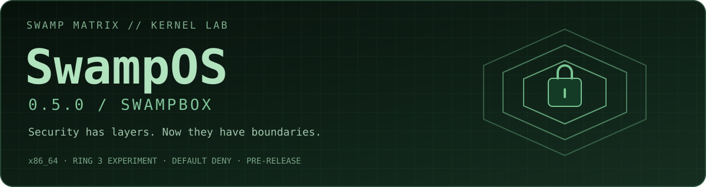
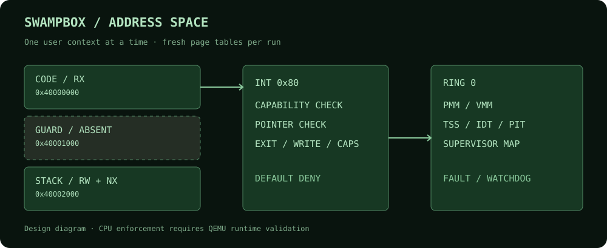
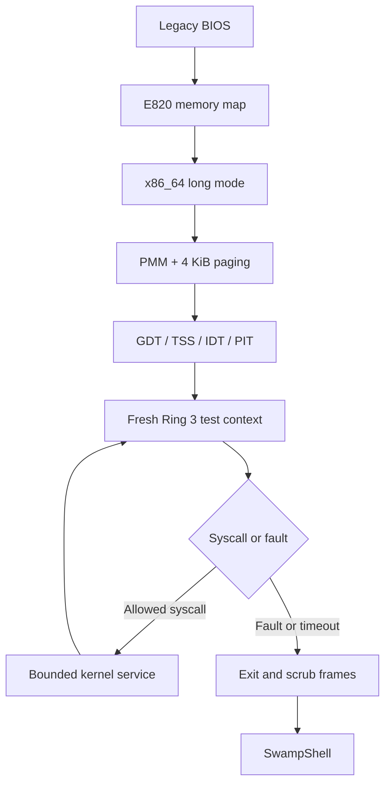
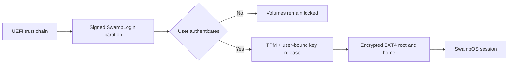

<div align="center">



[](RELEASE.md)
[](docs/ABI.md)
[](TEST-REPORT.md)
[](docs/TESTING.md)

**A security-first operating system built from scratch.**  
No Linux kernel. No distribution remix. An independent, experimental bare-metal OS.

[Quick start](#quick-start) · [Kernel](#inside-swampbox) · [Security](#the-onion-security-model) · [Roadmap](#roadmap) · [Release notes](RELEASE.md)

</div>

## The swamp is yours.

SwampOS aims to give the operator control over applications, devices, network traffic and data. Its long-term design combines a custom kernel, mandatory application isolation, protected pre-boot authentication, encrypted storage, defensive tooling and compatibility layers. **This release is an experimental kernel milestone, not a usable desktop or a production security product.**

### Release telemetry / 0.5.0

| 128 MiB | 4 KiB | 3 | 9 |
| :---: | :---: | :---: | :---: |
| Physical address ceiling | Page size | Syscalls | Guest self-tests (pending execution) |

| Build signal | Evidence |
|---|---|
| Raw boot image & ELF64 | Built; static validation passed |
| Cooperative context switching | 1,000 native host runs per build |
| PMM | Frame exhaustion, reservation, overlap handling and 100,000 churn iterations per build |
| VMM | 1,000 simulated address-space cycles per build, flags and OOM cleanup |
| Policy | Host-tested capability & bounded user pointer checks |
| Guest CPU | **Not verified**; QEMU unavailable in build environment |

See the [actual test report](TEST-REPORT.md) and [security boundaries](docs/SECURITY.md). No simulated test result is presented as a boot result.

## Quick start

Linux or WSL2 with GCC, GNU binutils, Make and Python 3; QEMU for guest execution.

```bash
./install.sh
make clean
make test       # host + static validation
make runtime    # mandatory guest gate; fails if QEMU is missing
make run        # interactive serial shell
```

The archive contains `build/SwampOS.img` (1 MiB raw BIOS image) and `build/kernel.elf` (debug/symbol inspection). To boot without rebuilding:

```bash
qemu-system-x86_64 -machine pc -cpu qemu64 -m 128M \
  -drive format=raw,file=build/SwampOS.img -serial stdio
```

Use a disposable VM. This release has no physical-disk installer and no verified boot chain. Verify artifact hashes with `cd build && sha256sum -c SHA256SUMS`.

## Inside SwampBox





**New in SwampBox:** BIOS E820 memory discovery, frame allocation from usable RAM, 4 KiB page tables, separated kernel RX/R/RW segments, NX, unmapped null page, per-run CR3, user code and stack isolation, TSS, interrupt-gated syscalls, exception classification, default-deny console permission and a timer watchdog. The original Donkey cooperative scheduler and Deep Onion arena/heap remain available.

### Console / operator reference

| Command | Purpose |
|---|---|
| `help`, `version`, `status` | Runtime and available commands |
| `pmm`, `mem` | New physical allocator / legacy arena statistics |
| `vmtest`, `sandbox` | Re-run address-space or built-in Ring 3 tests |
| `selftest`, `tasks`, `ticks` | Legacy core, cooperative scheduler, timer |
| `clear`, `onion`, `shrek`, `halt` | Console, lore, stop |

Expected startup transcript (illustrative, **not a captured run**):

```text
VM_TEST_OK
SwampBox: ring 3 hello
[user] syscalls PASS
[user] default deny PASS
[user] kernel access PASS
[user] code write PASS
[user] NX stack PASS
[user] port I/O PASS
[user] guard page PASS
[user] FPU disabled PASS
[user] watchdog PASS
USER_TEST_OK
CORE_TEST_OK
SwampOS 0.5.0 SwampBox
Security has layers.
BOOT_OK
swamp>
```

## The Onion Security Model

The target is layered, mandatory enforcement, not a UI-only permission manager.

| Layer | Current state | Target |
|---|---|---|
| SwampKernel | Experimental PMM/VMM and Ring 3 code | Hybrid Rust/C/ASM, SMP, preemption, hardened IPC |
| SwampBox / Onion | One built-in context at a time; console capability | Per-app mandatory default deny, revocation, quotas, sandboxed installers |
| SwampBoot | BIOS bootstrap only | UEFI Secure Boot, authenticated encrypted multiboot registry, anti-rollback |
| SwampLogin / Vault | Design only | Separate signed offline login partition; user authentication before EXT4 unlock |
| SwampWall / VPN | Design only | Per-app network policy, kill switch, split routing, DNS/IPv6 leak protection |
| SwampPKG | Design only | Signed `.swp`, SBOM, rollback, DEB/RPM/EXE import and isolation |
| SwampCompute | Design only | CUDA, ROCm, oneAPI, Vulkan, GPU mediation / isolated guests |
| SwampGUI | Design only | Dark green desktop, operator controls, system and defence applications |

### Pre-boot encryption (target, not implemented)



Planned: AES-XTS block encryption with independently designed integrity, RSA-OAEP key wrapping, Argon2id, TPM 2.0, authenticated recovery, encrypted swap and secure logout. No auto-unlock by TPM alone. No cryptographic implementation or LUKS2 compatibility is claimed today.

## The ecosystem / design targets

| Edition | Focus |
|---|---|
| Desktop | Daily use, office, media, browser, files |
| Defence | Authorized network defence, forensics, audit and isolated lab tools |
| Developer | SDK, compilers, language runtimes, debugging and containers/VM targets |
| Privacy | VPN, firewall, per-app routing, encrypted storage |
| Full | All four profiles in one shared secure core |

All profiles are presently metadata, not distinct functional installation images. Planned native `.swp` packages, Linux ABI/DEB/RPM, Win32/EXE via compatibility or isolated guests; open-source driver ports with license preservation; GPU acceleration with NVIDIA CUDA/OptiX, ROCm/HIP, oneAPI and Vulkan. VPN targets include Xray/sing-box, VLESS/REALITY, Hysteria2, WireGuard, OpenVPN and opt-in validation of publicly shared configs in isolation. See [full target architecture](docs/ARCHITECTURE.md).

## Repository map

```text
boot/           BIOS bootstrap + E820
kernel/         C and x86_64 assembly
  pmm.*         firmware-aware frame allocator
  vm.*          address spaces and permissions
  policy.*      capability rules
  user*         GDT/TSS, entry, syscall and test payloads
  core.*        interrupts, legacy allocation, timer
  task*         Donkey cooperative scheduler
assets/         local SVG banners and diagrams
docs/           architecture, ABI, security and testing
profiles/       five edition descriptors
legacy/         selected Donkey source/docs retained for comparison
tests/          host, static and guest gates
build/          compiled image, ELF, hashes and logs
.github/        CI workflow
```

## Roadmap

| Milestone | Status |
|---|---|
| 0.1 Genesis — custom bootstrap | Build delivered; guest unverified |
| 0.2 Onion — long mode | Build delivered; guest unverified |
| 0.3 Deep Onion — IRQs and basic memory | Build delivered; guest unverified |
| 0.4 Donkey — cooperative tasks | Host-tested |
| 0.5 SwampBox — PMM, paging, experimental Ring 3 | **Current; host-tested, guest pending** |
| Next — runtime hardening, process lifecycle, ELF loader, VFS | Planned |
| Vault — EXT4, pre-boot login, cryptography and recovery | Planned |
| Hardware — UEFI, device drivers, IOMMU, GPU | Planned |
| Connectivity — network stack and VPN | Planned |
| Ecosystem — package system, compatibility, desktop, CUDA | Planned |
| Full — all profiles | Long-term target |

## Contributing & security

Use small auditable patches, no fake PASS results, preserve upstream licenses, and keep implementation status explicit. See [security boundaries](docs/SECURITY.md), [ABI](docs/ABI.md), [testing](docs/TESTING.md), and [changelog](CHANGELOG.md). Licensing is not finalized; no third-party drivers are imported in this release. Do not assume redistribution rights for future proprietary GPU components.

<div align="center">

`root@swamp:~# security --layers`

**YOUR SYSTEM. YOUR RULES. YOUR SWAMP.**

</div>
