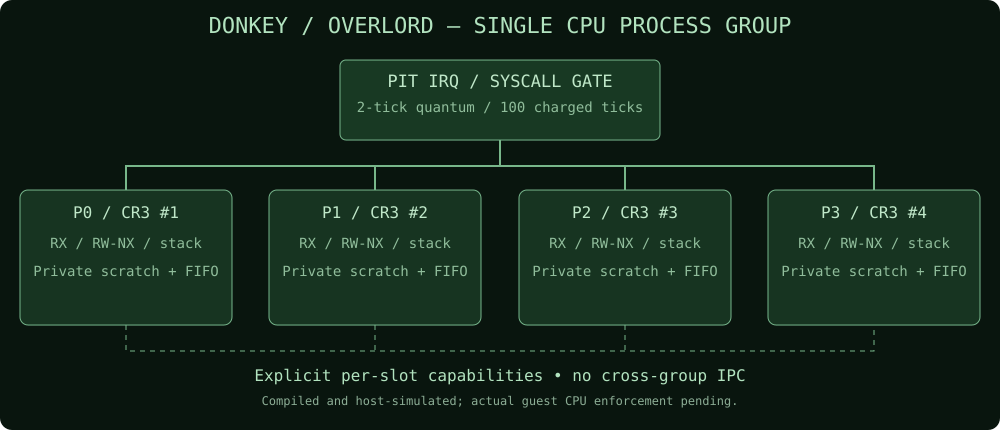

# Overlord 0.12.0 — process groups and native data ABI

## Scope and trust boundary

The new kernel path schedules up to four independent user contexts on one CPU. It is not a general-purpose process manager: a trusted shell starts a bounded group synchronously and waits for all members to exit. There is no `fork`, `exec`, background execution, blocking wait, filesystem write API, network syscall, SMP, floating-point support or device broker. Each group member can run a different validated native ELF; permissions are explicit per slot. Existing single-run resource snapshots remain available.



- Scheduler: round-robin, 2 charged PIT ticks per quantum, 100 charged ticks per member. Timer ticks are nominally 100 Hz, not a hard real-time limit. Explicit yield also rotates. Exit, recoverable user fault and budget expiry select the next runnable task. Faults and budget expiry become result codes; group memory is released after the final member exits.
- Context: GPRs, user RIP/RSP/RFLAGS, CS/SS and CR3. Interrupt gate keeps transitions serialized; the kernel mapping and kernel stack are shared. FS/GS bases are zeroed and user FSGSBASE is disabled; x87/SIMD remain disabled. No general architectural context support (e.g. debug registers, XSAVE).
- IPC: group-local slot indexes, both endpoints must hold CAP_IPC. Four FIFO messages per destination, maximum 64 bytes each. Nonblocking send/receive, no global namespace, no network/USB access. Empty/full queue returns -11, too-small destination returns -90 without consuming, exited peer returns -32, invalid size/self target returns -22, unauthorized destination returns -1. Slot identifiers are ephemeral, not global process handles. Queue entries and group state are wiped.
- Scratch: CAP_SCRATCH grants a private 1024-byte volatile byte store. Read/write requests are at most 256 bytes. Writes cannot create holes or extend beyond 1024 bytes. Reads at/after EOF return 0. The scratch buffer is wiped on exit, fault, timeout and group teardown. This is not a filesystem or durable storage.
- ELF: prior one-page RX profile remains accepted. Optional second PT_LOAD must be RW, at 0x40004000, max 4096 bytes, aligned/disjoint, file size <= memory size. BSS is zero-filled, data has NX, guard at 0x40003000. Syscalls permit the data page only if mapped. No dynamic loader or foreign execution. See ABI.md and STORAGE.md.
- Console output from a user program replaces non-printable control bytes (except tab and LF) with dots. Audit group events use run IDs in the detail field. Audit remains a 64-event volatile diagnostic ring, not durable logging.

## Shell commands

```text
process-test
scratch-test
run /bin/overlord-demo
run-scratch /bin/overlord-demo
run-pair /bin/overlord-demo
run-group n:/bin/hello c:/bin/sdk-demo
run-group a:/bin/overlord-demo a:/bin/overlord-demo
```

`run-pair` explicitly grants console, IPC and scratch to both copies. `run-group` takes 2–4 entries with prefixes `n` (no grants), `c` (console), `i` (IPC), `s` (scratch), `a` (all three). The shell line is bounded to 127 characters. Paths cannot contain spaces. CAP_DATA is available only through the existing single-run command; it is not implicitly given to groups. IPC can transfer data intentionally to another authorized member, not directly read its memory.

Expected results: `run` returns 13; `run-scratch` prints SCRATCH_OK and returns 0; `run-pair` prints IPC_PING_OK and IPC_PONG_OK and returns 0 0. The pair demo requires timer preemption because its first role waits for the second before voluntarily yielding. The group with different grant masks returns 13 0. These are guest test assertions, not a captured boot transcript.

## Verification

`make overlord-host-test` executes the process model, scratch, actual trap dispatcher with mocked entry/CR3, and EXT4/ELF read-back. The existing VM host test checks real page-table construction and zeroed BSS using simulated physical RAM. `make runtime` must additionally pass on QEMU to validate actual instruction execution. No hardware enforcement or production sandbox certification is implied by host test results.
