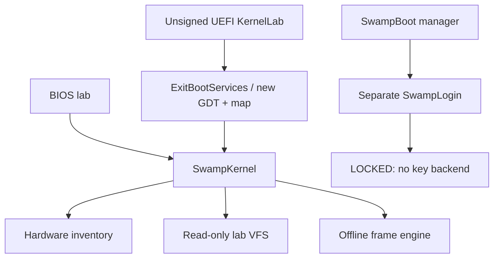

<div align="center">


[](RELEASE.md)
[](docs/ABI.md)
[](docs/ARCHITECTURE.md)
[](docs/BOOT.md)
[](TEST-REPORT.md)
[](docs/NETWORK.md)

**A security-first operating system built from scratch.**  
No Linux kernel. No distribution remix. An independent bare-metal OS research project.

[Quick start](#quick-start) · [Hardware](#hardware-awakening) · [Boot](#three-independent-lab-paths) · [Storage](#swampfs) · [Networking](#network-foundation) · [Security](#onion-security-model) · [Roadmap](#roadmap) · [Release](RELEASE.md)

</div>

## `> whoami`

SwampOS is an independent security-first operating system project, built around a custom kernel, mandatory application isolation as a design goal, user-mediated hardware/network permissions, verified boot, encrypted storage, application compatibility and an open-source defensive software ecosystem. This release adds the first experimental UEFI-to-kernel handoff and a substantial hardware and storage foundation, without compromising the separate locked SwampLogin chain.

| x86_64 | 60 KiB | 128 MiB | 4 |
| :---: | :---: | :---: | :---: |
| Architecture | BIOS payload limit | Managed RAM ceiling | Guest integration gates |

> [!IMPORTANT]
> **Experimental pre-release — not production security software.** QEMU/OVMF execution is not locally verified. The unsigned `KernelLab-GPT.img` and BIOS images are plaintext development paths. The original separate SwampLogin remains locked, never collects credentials, never releases keys and never boots the kernel. Do not enroll lab EFI executables as trusted, install these images on real disks, or store secrets in them. [Security boundaries](docs/SECURITY.md).

## What's new in 0.8.0

| Layer | Engineering delta | Evidence |
|---|---|---|
| UEFI | `KERNELLAB.EFI`: embeds raw kernel, fixed RAM reservation, memory map conversion, `ExitBootServices`, GDT/page-table handoff | PE build, host map tests, image extraction |
| BIOS | 120-sector load, 60 KiB payload, firmware-mode entry separation | Static image validation |
| CPU | CPUID features and processor metadata | Compiled kernel |
| ACPI | RSDP/RSDT/XSDT, MADT and MCFG checksum/length validation | Host fixtures + mutations |
| PCI | Controller classification, BAR decoding, PCIe/MSI/MSI-X/VirtIO capability inventory | Host config fixtures + mutations |
| Input | i8042 polling, US translated Set 1, modifier state | Host decoder tests |
| Display | GOP geometry/format metadata, UEFI serial-only console | Compiled firmware and kernel |
| Storage | Bounded partition block views; one read-only GPT/EXT4 mount; public demo image | Actual GPT/EXT4 host reads |
| Network | Ethernet II, ARP, IPv4, ICMP and UDP frame engine | Offline fixtures + random frames |
| Security | SwampLogin lock invariant retained, networking remains unavailable to applications | Previous host policy and login tests |

## Quick start

Linux / WSL2. Use GCC, GNU binutils, Clang, LLD, Python 3, libext2fs, cryptography, QEMU and OVMF.

```bash
(cd build && sha256sum -c SHA256SUMS)  # verify supplied artifacts before clean
./install.sh
make clean
make -j4 all
make test                 # host and static gates
make checksums            # local build manifest
```

`SHA256SUMS` belongs to the distributed build. `make clean` removes it; use `make checksums` after rebuilding to create a new local manifest (not an independent release authenticity proof). To verify the original download, run the checksum command before rebuilding.

Run the BIOS lab (plain EXT4 fixture, no network adapter):

```bash
make run
```

Run the new GPT-backed storage lab:

```bash
make run-storage-lab
# at the SwampShell prompt:
gpt
mount-gpt 1
ls /bin
cat /welcome.txt
run-console /bin/hello
umount
```

Guest validation is intentionally separate:

```bash
make runtime              # BIOS / bare EXT4
make uefi-runtime         # OVMF -> locked SwampLogin
make kernel-lab-runtime   # independent OVMF -> experimental kernel
make storage-lab-runtime  # BIOS -> GPT partition mount
```

The runtime commands require QEMU, and the UEFI commands require a matching non-Secure-Boot OVMF CODE/VARS template. They fail if prerequisites are missing; they never synthesize success. CI also runs these gates and retains any generated logs.

## Three independent lab paths


| Image | Purpose | Important boundary |
|---|---|---|
| `SwampOS.img` | BIOS boot sector + raw x86_64 kernel | Plaintext lab only |
| `SwampBoot-GPT.img` | UEFI manager -> separate login partition | Stops locked; no handoff |
| `KernelLab-GPT.img` | Independent unsigned UEFI-to-kernel experiment | No credentials, empty ROOT/HOME |
| `StorageLab-GPT.img` | Public GPT-backed EXT4 demo | Attach as secondary IDE, no boot |
| `vault.ext4` | Existing native ELF / EXT4 fixture | Public, unencrypted, read-only |



The handoff is an experimental independent implementation, not a bypass of the locked manager: only the separate lab image contains it. The lab rejects Secure Boot enabled and LA57, reserves 1–4 MiB, copies the raw kernel to 1 MiB, builds a temporary 4 GiB identity map, converts only conventional RAM below 128 MiB, retries stale memory-map keys, and transfers without further firmware calls. Kernel memory management replaces the temporary map. Firmware execution remains unverified. [Boot specification](docs/BOOT.md).

## Hardware Awakening

| Command | Diagnostic or operation |
|---|---|
| `cpu` | Vendor, CPUID logical IDs and APIC/VMX/NX/SMEP/SMAP flags |
| `acpi` | Enabled processors, IOAPIC count, IRQ overrides, MCFG presence |
| `pci` | PCI bus/device/function and IDs |
| `devices` | AHCI/NVMe/xHCI/Ethernet/display/VirtIO classes and capabilities |
| `firmware` | BIOS/UEFI mode; GOP width, height, stride and format in UEFI |
| `pmm` / `vmtest` | Frame statistics and address-space self-test |

The PCI layer reads configuration space without enabling bus mastering or programming BARs. ACPI tables are bounded and checked before traversal. Inventory is **not** driver support; no APIC routing, SMP, AHCI, NVMe, xHCI, VirtIO transport, USB, mouse, graphics output, IOMMU or CUDA runtime is implemented. PS/2 input is a polling path for firmware-translated Set 1 only. [Hardware details](docs/HARDWARE.md).

## SwampFS

```text
ATA PIO -> bounded block device -> validated GPT -> partition view
         -> constrained EXT4 reader -> single VFS mount -> native ELF64
```

- 512-byte sectors; 4 KiB EXT4 blocks; up to 64 KiB file size; one active read-only mount.
- Validated primary and backup GPT with CRC32 and nonoverlapping partition checks.
- Explicit `mount-gpt N` for Linux-filesystem GUID only; SwampVault GPT types are rejected.
- No filesystem writes, journal replay, multi-mount namespaces or transparent block encryption.
- External ELF is restricted to the existing native test ABI; explicit console grants remain required.

[Storage specification](docs/STORAGE.md) · [ABI](docs/ABI.md)

## Network foundation

| Protocol | Implemented offline | Not implemented |
|---|---|---|
| Ethernet II | Bounded frame decode, local destination checks | NIC TX/RX |
| ARP | Local IPv4 request/reply | Neighbor cache |
| IPv4 | Length/checksum, no fragments or options | Routing, reassembly |
| ICMP | Echo request/reply | Full ICMP handling |
| UDP | Checksummed port-7 echo | Sockets and transport API |
| TCP/IPv6/DNS | — | Planned |

`net` reports the scope; `nettest` executes local fixtures and prints `NET_TEST_OK` on success. No packet is transmitted. No NIC, system VPN, firewall or per-app network routing is implemented. [Network design](docs/NETWORK.md).

## Onion security model


```text
HARDWARE -> SWAMPKERNEL -> ONION POLICY -> SWAMPBOX -> APPLICATION
                |               |              |
             PMM/VMM       capabilities    separate roots
```

Existing experimental Ring 3, TSS, interrupt-gated syscalls, NX, guard page, default-deny console grants, watchdog and scrubbed user frames are retained. The kernel uses a shared supervisor physical mapping; this is not physical-frame-wide W^X. Application isolation is not yet a production sandbox. No DMA isolation, preemptive user process scheduler, SMP, or general device permission broker exists.

### SwampVault and verified login — target, not yet integrated


The protected target remains **encrypted EXT4 ROOT/HOME unlocked only after user authentication in an independent signed SwampLogin partition**. AES-XTS block encryption with designed integrity protection, RSA-OAEP key wrapping, Argon2id, TPM sealing and signed recovery are architecture targets. Existing host `tools/vault.py` performs RSA-4096/AES-256-GCM whole-image envelope authentication; `tools/boot_registry.py` signs/encrypts offline registry records. These are not kernel disk encryption, not a native login backend, and not hardware anti-rollback. The default locked UEFI image has empty ROOT/HOME and accepts no passwords.

[Vault](docs/VAULT.md) · [Boot chain](docs/BOOT.md) · [Security](docs/SECURITY.md)

## SwampShell

Illustrative target transcript — **not a captured boot log**:

```text
SwampOS 0.8.0 Hardware Awakening
Security has layers.
BOOT_OK
swamp> firmware
UEFI plaintext kernel lab
swamp> net
Offline frame engine: Ethernet / ARP / IPv4 / ICMP / UDP. No NIC, sockets, TCP or Internet.
swamp> nettest
NET_TEST_OK
swamp> shrek
WHAT ARE YOU DOING IN MY SWAMP?!
```

Other commands: `help`, `clear`, `version`, `status`, `onion`, `mem`, `ticks`, `tasks`, `selftest`, `sandbox`, `fscheck`, `storage`, `ls`, `cat`, `run`, `run-console`, `halt`. `BOOT_OK` is gated by kernel VM/user/core/network tests and the storage test when a demo volume is mounted.

## Five editions — one shared kernel

| Edition | Intended role | Current state |
|---|---|---|
| Desktop | Daily use and graphical applications | Profile manifest only |
| Defence | Authorized defensive security, network/forensics tools | Profile manifest only |
| Developer | SDK, compilers, language runtimes | Profile manifest only |
| Privacy | VPN, per-app routing, encrypted storage | Profile manifest only |
| **Full** | Union of the four profiles | Profile manifest only |

## Roadmap

| Subsystem | Evidence / next gate |
|---|---|
| SwampKernel / Donkey | Freestanding C/ASM, memory/scheduler host tests; guest runtime pending |
| SwampBox / Onion | Experimental Ring 3 and policy; guest and independent audit pending |
| SwampFS | Read-only EXT4 and single partition mount; writes and full VFS pending |
| SwampBoot / SwampLogin | Separate locked chain, unsigned independent UEFI lab; native authentication pending |
| SwampVault | Offline encryption, native encrypted block I/O pending |
| Hardware | Discovery and limited PS/2; APIC/SMP/USB/storage/NIC/GPU drivers pending |
| SwampNet / SwampWall | Offline frame engine; NIC, TCP/IPv6, sockets and firewall pending |
| SwampVPN | Xray/sing-box port, VLESS/REALITY, Hysteria2, WireGuard, OpenVPN and per-app routing planned |
| SwampPKG | Signed `.swp`, DEB/RPM import, immutable/atomic updates planned |
| SwampUnix / SwampWin | Linux ABI, Win32/EXE compatibility planned |
| SwampCompute | CUDA/ROCm/oneAPI, mediated GPU and isolated guest compute planned |
| SwampGUI / SDK | Desktop, native apps, Rust/toolchains and developer ecosystem planned |
| Full Edition | Integration, installation, recovery and independent audit planned |

The detailed target remains in [ARCHITECTURE.md](docs/ARCHITECTURE.md). Third-party driver and application ports must preserve license/attribution. Project license is not yet finalized; do not assume the release is already under GPL or that proprietary CUDA components are redistributable.

## Test evidence and repository

See [TEST-REPORT.md](TEST-REPORT.md) for actual local test runs and [CHANGELOG.md](CHANGELOG.md) for history. Build scripts are in `Makefile`, CI in `.github/workflows/`, tests in `tests/`, boot code in `boot/`, kernel code in `kernel/`, independent applications in `userspace/`, provisioning/crypto in `tools/`, assets in `assets/` and earlier documents in `legacy/`. The release ships full source, compiled images, manifests, notes, diagrams and test logs. [Tree](TREE.txt).

<div align="center">

**SWAMP MATRIX // SWAMP OS**  
`YOUR SYSTEM. YOUR RULES. YOUR SWAMP.`

</div>
