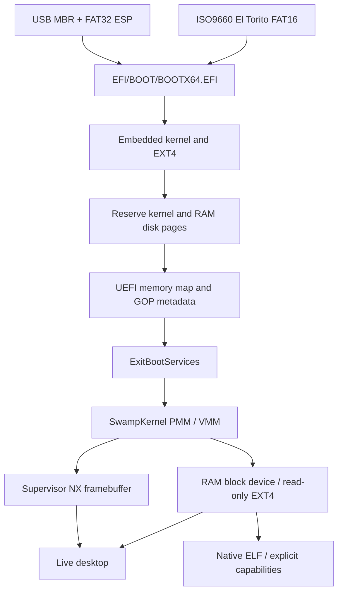

<div align="center">


[](RELEASE.md)
[](docs/ABI.md)
[](docs/LIVE.md)
[](#swampgui--live-desktop)
[](TEST-REPORT.md)
[](docs/GIT-LFS.md)

**A security-first operating system built from scratch.**  
No Linux kernel. No distribution remix. An independent bare-metal OS research project.

[Quick start](#quick-start) · [Desktop](#swampgui--live-desktop) · [Architecture](#boot-architecture) · [Tools](#terminal) · [Security](#security-boundaries) · [Status](#subsystem-status) · [Roadmap](#roadmap) · [Release](RELEASE.md)

</div>

## `> whoami`

Farkuad is the first **Live preview** milestone of SwampOS, built directly on Overlord. The custom x86_64 kernel now contains a keyboard-driven framebuffer desktop, a real terminal and utilities, and a read-only RAM-backed EXT4 volume carrying native ELF64 applications. The standalone removable-media image includes its own UEFI loader, kernel and filesystem. It does not need an installed OS or a second disk.

| x86_64 | 81 MiB | 8 MiB | 5 | 11 |
| :---: | :---: | :---: | :---: | :---: |
| Architecture | Live image | RAM EXT4 | Desktop tools | Native syscalls |

> [!IMPORTANT]
> **Unsigned experimental live preview, not production security software.** The desktop and boot chain have been built and host-tested. Actual USB/UEFI execution in QEMU/OVMF and on physical PCs is not verified. Native USB input, GPU drivers, encrypted root and actual pre-boot authentication are unfinished. Use an isolated test system, not a production or managed PC. Do not store secrets or install to an internal disk.

## Quick start

**ISO revision:** Farkuad now uses one hybrid UEFI ISO for raw USB flashing and virtual optical boot. The kernel release remains 0.13.0; the previous Live IMG is retired from the default build. Other laboratory disk fixtures are unchanged in purpose.

Extract the full release archive, then use Linux or Windows + WSL2 (Ubuntu/Debian):

```sh
./install.sh
bash scripts/build-live.sh
```

`build/Farkuad-Live.iso` is the hybrid ISO9660 / El Torito + MBR/FAT32 image to write to a disposable USB stick; it is also supplied prebuilt in the release. Verify the checksum:

```sh
(cd build && sha256sum -c Farkuad-Live.iso.sha256)
```

Windows: use a raw-image USB writer (e.g. balenaEtcher), select the **ISO in raw/DD mode**, select the correct USB drive, flash and verify. A full drive image is not an ordinary file copy. Linux users can use the guarded `scripts/flash-live.sh` after identifying and unmounting the removable USB. **Flashing erases the selected drive.** Read [the complete Live guide](docs/LIVE.md) before attempting physical hardware.

```sh
make live-host-test  # model / renderer / RAM EXT4 / image structure
make live-runtime    # real QEMU/OVMF USB boot gate; requires installed tools
make live-optical-runtime  # same ISO as a virtual CD/DVD
```

## SwampGUI — Live Desktop


*Actual output of the C renderer in the host test harness, with illustrative terminal contents. This is not a guest or physical-hardware screenshot.*

| Desktop tool | Implementation |
|---|---|
| Terminal | Existing kernel shell; bounded scrollback and keyboard input |
| Notes | Editable, volatile 512-byte buffer |
| Calculator | Signed integer arithmetic, checked input, division-by-zero rejection |
| Monitor | Actual kernel tick and frame counters in the guest design |
| Files | Read-only RAM EXT4 text, hex and directory previews |

**Tab** switches tools; **Escape** returns to the terminal. PS/2 set-1 keyboard and COM1 serial input are the current interfaces. No mouse, multiwindow compositor, native USB HID, persistent desktop files or full GUI application SDK yet.

## Boot architecture




The Live image is deliberately separate from the existing GPT SwampLogin image. An unsigned lab EFI path cannot unlock encrypted volumes. Physical-disk discovery/mount commands are blocked before ATA access in Live mode; the explicit network driver lab is not dispatched. The boot disk is read by firmware, not a native USB storage driver.

## Terminal

| Command | Function |
|---|---|
| `help`, `version`, `status`, `clear` | Kernel console basics |
| `cpu`, `pci`, `devices`, `firmware`, `acpi` | Hardware inventory |
| `pmm`, `mem`, `ticks`, `tasks` | Kernel diagnostics |
| `audit`, `sandbox`, `vmtest`, `process-test` | Security / process diagnostics |
| `storage`, `fscheck`, `ls /bin`, `cat /welcome.txt` | Read-only filesystem tools |
| `umount`, `mount-live` | RAM volume lifecycle |
| `run-console /bin/sdk-demo` | Native C SDK application with explicit console grant |
| `run-pair /bin/overlord-demo` | Bounded group and IPC demonstration |
| `nettest`, `transport`, `wall`, `vpn-policy` | Offline network/policy self-tests |
| `shrek`, `onion`, `halt` | Essential swamp utilities |

The embedded EXT4 contains `hello`, `sdk-demo`, `integration-demo`, `overlord-demo`, `welcome.txt` and `pattern.bin`. Notes are not written to this volume. Existing package manager and compatibility tools are host-side, not installed native desktop applications.

## Security boundaries

- The desktop UI is a trusted kernel component. It does not itself implement mandatory third-party application sandboxing.
- Framebuffer mappings are supervisor-only, NX and outside user memory; address-space construction and allocation rollback have host tests.
- The RAM-disk adapter validates capacity and firmware usable-range overlap. The live filesystem is read-only and unencrypted.
- Network activation and physical ATA/GPT mounting are intentionally disabled for the live route. No automatic changes to disks or firmware settings.
- Secure Boot, TPM-bound key release and disk encryption remain required goals for the installed OS. The separate SwampLogin path stays locked; no password is requested or key released by Farkuad.

## Subsystem status

| Subsystem | Current implementation | Not yet complete |
|---|---|---|
| SwampKernel | Custom x86_64 C/ASM, PMM/VMM, IDT, NX | Rust, SMP, real hardware validation |
| Overlord / Donkey | Bounded process groups, cooperative kernel tasks, 11-call ABI | General process lifecycle, SMP, verified guest execution |
| SwampBox / Onion | Experimental Ring 3, explicit capabilities, local IPC | Full mandatory application sandbox and GUI permission manager |
| SwampBoot / SwampLogin | BIOS lab, UEFI handoff, separate locked login partition | Signed secure chain, actual authentication and unlock |
| SwampVault | Offline RSA-OAEP/AES-GCM host toolkit | Transparent AES-XTS block encryption, TPM, encrypted root and home |
| SwampFS | Read-only EXT4, VFS, RAM-disk adapter | Persistent writes, journaling, broad filesystems |
| SwampGUI | Kernel live desktop with five tools, software rendering | Mouse, compositor, USB HID, GPU acceleration |
| SwampNet / SwampWall | Protocol parsers, VirtIO lab, endpoint policy models | Sockets, real TCP stack, enforced firewall |
| SwampVPN | Offline URI inspection and routing policy | Xray/sing-box integration, tunnels, config discovery and per-app routing |
| SwampPKG | Signed `.swp` host store, staging, rollback | Native installation and runtime signature verification |
| SwampUnix / SwampWin | ELF, DEB, RPM and PE inspection | Linux ABI, Win32/Wine, actual DEB/RPM/EXE execution |
| SwampCompute | Design target | CUDA/ROCm/oneAPI, GPU driver and runtime integration |
| SwampSDK | Native C header and ELF link scripts | libc, full language runtimes and GUI SDK |

## Five editions (design targets)

Desktop · Defence · Developer · Privacy · Full. Profiles are retained; Farkuad is one common experimental Live build, not five fully functioning distributions. Full Edition remains the planned combined release. Driver porting must preserve upstream licenses; no Linux kernel module compatibility is claimed.

## Build and contribute

```sh
make clean
make -j4 all
make test
make checksums
make live-runtime
```

See [the test report](TEST-REPORT.md), [live guide](docs/LIVE.md), [architecture](docs/ARCHITECTURE.md), [ABI](docs/ABI.md), [security](docs/SECURITY.md), [boot](docs/BOOT.md), [storage](docs/STORAGE.md), [package format](docs/PACKAGES.md), [network](docs/NETWORK.md) and [Git LFS](docs/GIT-LFS.md). Previous Overlord documentation is preserved in `legacy/`.

The archive contains build artifacts, not just a source snapshot. Git LFS tracks disk images; do not accidentally commit large raw Git blobs. Install LFS and stage files before invoking `python3 scripts/check-git-index.py`. Publish the compressed complete release in GitHub Releases. Local graphics are checked into `assets/`.

## Roadmap

| Milestone | Gate |
|---|---|
| Farkuad Live Preview | Host-tested UI, removable image, RAM EXT4; guest gate pending |
| Live hardware stabilization | QEMU/OVMF USB boot, PS/2 and USB HID, ACPI/APIC, physical validation |
| Secure Platform | Signed trust chain, separate SwampLogin, encrypted root/home, TPM, recovery |
| Desktop & Connectivity | Compositor, persistent files, USB/NVMe, TCP/IP sockets, VPN and firewall |
| Application Ecosystem | Native SWP, DEB/RPM/EXE execution compatibility, runtimes, GPU/CUDA |
| 1.0 / The Swamp | Installer, five editions, test matrix, security review and audit |

No release should be marked production-ready based on host tests alone.

<div align="center">

**SWAMP MATRIX // SWAMP OS**  
`YOUR SYSTEM. YOUR RULES. YOUR SWAMP.`

</div>
