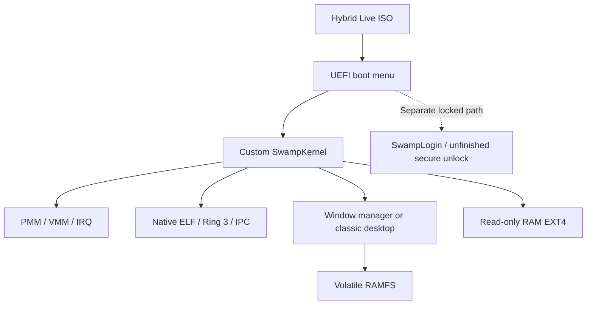

<div align="center">


[](docs/AWAKENS.md)
[](RELEASE.md)
[](docs/ABI.md)
[](docs/LIVE.md)
[](TEST-REPORT.md)
[](docs/GIT-LFS.md)

**Security has layers. The swamp awakens.**

[Quick start](#quick-start) · [Desktop](#swampgui) · [Storage](#swampfs) · [Architecture](#architecture) · [Features](FEATURES.md) · [Missing](MISSING.md) · [Tests](TEST-REPORT.md)

</div>

## `> whoami`

SwampOS is an independent bare-metal x86_64 operating system project, not a Linux distribution. Farkuad 0.13.1 is the user-confirmed VirtualBox checkpoint. Awakens develops the target 0.20.0 through cumulative internal builds, not new public version tags for each feature.

| x86_64 | 81 MiB | 5 | 16 × 4 KiB | 11 |
| :---: | :---: | :---: | :---: | :---: |
| Architecture | Live ISO | Windowed tools | Volatile files | Native syscalls |

> [!IMPORTANT]
> Experimental unsigned Live environment. New builds are host-tested, not yet validated in a guest or on physical hardware. Desktop tools are trusted kernel components, not isolated apps. This is not a secure installed OS. The independent locked SwampLogin route is unchanged. No writes to physical disks from the Live route.

## Quick start

Extract the full checkpoint archive. To use the prebuilt hybrid UEFI ISO, select `build/Farkuad-Live.iso` in VirtualBox or a raw USB writer. The historical filename is preserved for build-script compatibility.

```sh
(cd build && sha256sum -c Farkuad-Live.iso.sha256)
# Linux / Ubuntu WSL2, build from source:
./install.sh
bash scripts/build-live.sh
make test
make checksums
```

VirtualBox: x64 EFI enabled, 1 CPU, 512–1024 MiB RAM, PS/2 Mouse (not USB Tablet), VBoxSVGA, no 3D acceleration, no network. Use a disposable VM. For physical USB use a raw/DD writer; **flashing erases the selected USB drive**. The guarded Linux script is `scripts/flash-live.sh`. Read [Live guide](docs/LIVE.md) before writing a drive. Do not change Secure Boot on a production or managed PC.

```sh
make live-runtime          # QEMU/OVMF USB boot
make live-optical-runtime  # QEMU/OVMF optical boot
```

## Boot menu

```text
              _______________
         ___ /               \ ___
        (___)  _          _   (___)
            | (o)        (o) |
            |       __       |
            |    ._______.   |
             \     -----    /
              '------------'

         SWAMPOS / AWAKENS DEV 02
       ITS YOUR SWAMP - ITS YOUR LIFE

     > 1. Live Desktop (keyboard + PS/2 mouse)
       2. Classic Desktop (keyboard only)
       3. Serial recovery console (COM1)
       4. Return to firmware

   Autoboot in 10 seconds
```

Native UEFI menu, not GRUB. Arrow keys, Enter, digits 1–4, Esc. The 10-second delay is based on firmware stalls; rendering can add overhead.

## SwampGUI


*Actual output of the C renderer in the host harness, with illustrative content; not a guest screenshot.*

The first boot option enables overlapping windows, launcher, desktop icons, z-order, focus, taskbar, mouse dragging/resizing and minimize/maximize/restore/close. Tab opens the next tool, Esc opens Terminal. The second option keeps Farkuad's original tab interface. The client views are bounded; no GPU acceleration, clipboard or independent GUI processes yet.

| Tool | Available behavior |
|---|---|
| Terminal | Native kernel shell and scrollback |
| Notes | 512-character editor; Save/Load to volatile notes.txt |
| Calculator | Checked signed integer arithmetic |
| Monitor | Kernel timer and physical frame counts |
| Files | Embedded EXT4 text, binary and /bin previews |

## SwampFS

The embedded 8 MiB EXT4 remains read-only. Build 02 adds a separate volatile flat RAMFS namespace, not persistent EXT4 writes.

```text
swamp> ramwrite hello.txt hello swamp
swamp> ramcp hello.txt copy.txt
swamp> rammv copy.txt final.txt
swamp> ramls
swamp> ramcat final.txt
swamp> ramrm hello.txt
swamp> ramstat
```

16 files, up to 4,096 bytes each, restricted names, copy/rename collision checks, bounded reads and clearing of deleted/truncated data. Notes Save/Load uses the same namespace. All RAMFS files vanish at reboot. No directory hierarchy, file syscalls or persistent storage yet.

## Architecture



| Subsystem | Current scope |
|---|---|
| SwampKernel / Overlord | x86_64, paging, limited process groups, IPC |
| SwampBox / Onion | Experimental capability enforcement; GUI remains trusted |
| SwampBoot / SwampLogin | BIOS lab and UEFI Live; separate locked login |
| SwampVault | Offline RSA/AES prototype, not transparent disk encryption |
| SwampNet / SwampWall / SwampVPN | Parsers, experimental VirtIO lab, policy models |
| SwampPKG | Signed host package store, native ELF staging |
| SwampUnix / SwampWin | Format inspection, not foreign program execution |
| SwampCompute | CUDA/ROCm/oneAPI planned |

## Development and verification

- [Checkpoint plan and architectural decisions](docs/AWAKENS.md)
- [Feature ledger](FEATURES.md), [unfinished requirements](MISSING.md), [actual file delta](DIFF-REPORT.md), [complete tree](TREE.txt)
- [Native ABI](docs/ABI.md), [security](docs/SECURITY.md), [network](docs/NETWORK.md), [packages](docs/PACKAGES.md), [input](docs/INPUT.md)
- [Current test report](TEST-REPORT.md), [release notes](RELEASE.md), [changelog](CHANGELOG.md)

```sh
make window-host-test
make ramfs-host-test
make live-host-test
make test
```

The full source archive includes actual build logs and SHA-256 checksums. Historical reports live in `legacy/` and are not current evidence. Git LFS tracks disk images; run `python3 scripts/check-git-index.py` before committing.

---

<div align="center">

**SWAMP MATRIX // SWAMP OS**

`ITS YOUR SWAMP - ITS YOUR LIFE`

</div>
