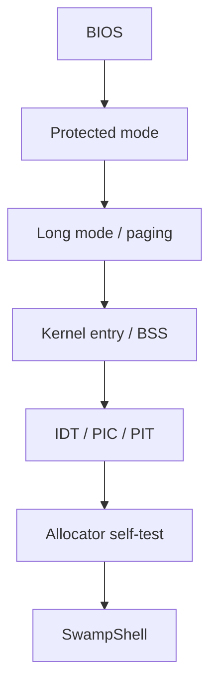
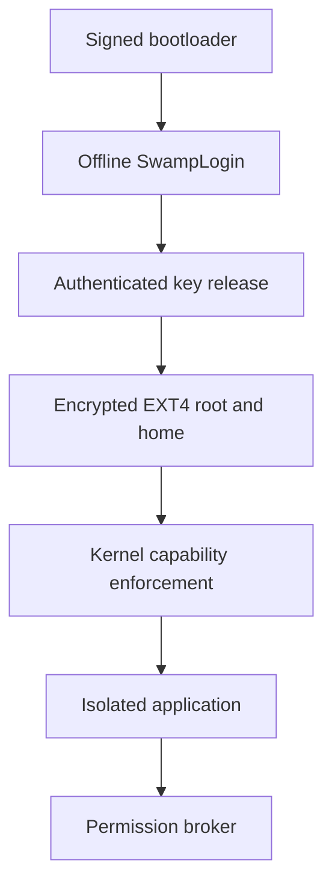
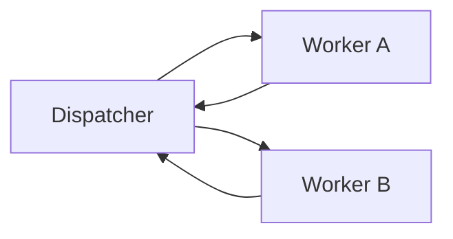

<div align="center">


# S W A M P O S

**SECURITY HAS LAYERS.**


*A security-first operating system built from scratch.*

[Donkey](#donkey) · [Build](#build--run) · [Architecture](#target-architecture) · [Roadmap](#roadmap)

</div>

---

## Donkey

SwampOS is an independent bare-metal OS development project, not a Linux distribution. Its long-term goal is a custom kernel with mandatory application isolation, encrypted storage, verified multiboot, cross-platform application compatibility and integrated cyber defence tools.

The current release adds an interrupt subsystem, PIT timer and reserved-memory allocators to the experimental **64-bit BIOS bootstrap with initial identity paging**, written in C and x86 assembly. The intended production architecture is x86_64 / UEFI with Rust, C and assembly.

```text
[ BUILT    ] BIOS boot sector + freestanding kernel
[ BUILT    ] Raw bootable disk image
[ PRESENT  ] Long-mode transition, supervisor-only initial paging, VGA and serial console
[ PRESENT  ] Minimal SwampShell and image validation tests
[ PENDING  ] QEMU runtime boot verification
[ PLANNED  ] Memory isolation, secure boot, encrypted storage
```

## Under the hood

| Component | Current implementation | Boundary |
| :-- | :-- | :-- |
| Page allocator | 32 aligned 4 KiB pages, zero on allocation, invalid/double-free rejection | Reserved BSS arena, not full PMM |
| Kernel heap | 8 KiB aligned bump allocator | No individual free |
| IDT | 256 gates, 32 exception entries | Fatal exceptions halt; no recovery or IST |
| Interrupt controller | Legacy 8259 PIC remapped to 32–47 | Only IRQ0 enabled |
| Timer | PIT, nominal 100 Hz | No preemption |
| Donkey scheduler | Two cooperative kernel tasks, separate 4 KiB stacks | Shared address space; no process isolation |
| VMM | Inherited 1 GiB identity mapping | No dynamic mapping or W^X |



### Console field guide

| Command | Action |
| :-- | :-- |
| `tasks` | Run two cooperative workers, five steps each |
| `mem` | Show reserved page usage |
| `ticks` | Read timer interrupt counter |
| `selftest` | Exercise allocator exhaustion, alignment, reuse and invalid frees |
| `status` | Report bootstrap limitations |
| `help`, `version`, `clear` | Console utilities |
| `onion`, `shrek` | Swamp culture |
| `halt` | Stop the CPU |

## Build & run

On Debian / Ubuntu or WSL2, from the repository root:

```bash
sh install.sh
make clean
make test
make run
```

Run the separate boot smoke test after building:

```bash
python3 tests/boot.py
```

The generated image is `build/SwampOS.img` (RAW, not ISO). Use a disposable VM; do not write this experimental image to a physical disk. The VGA display mirrors output; input is through the serial terminal.

### SwampShell

Expected console output (not a verified runtime transcript):

```text
SwampOS 0.4.0 Donkey
Security has layers.
BOOT_OK
swamp> help
help clear version onion shrek status mem ticks selftest halt
```

## Target architecture

The following components are design goals, not active security features.

| Subsystem | Purpose |
| :-- | :-- |
| SwampKernel | x86_64 hybrid kernel, paging, scheduling, IPC and capabilities |
| SwampBox / Onion | Mandatory default-deny isolation, per-app permissions, quotas and microVMs |
| SwampBoot | Verified UEFI multiboot, authenticated encrypted boot registry, TPM and anti-rollback |
| SwampLogin / SwampVault | Separate signed offline pre-boot login; encrypted EXT4 volumes unlocked after authentication |
| SwampPKG | Signed `.swp` packages, SBOM, dependencies, atomic updates and rollback |
| SwampUnix / SwampWin | DEB/RPM and Linux ABI; PE/EXE/MSI via compatibility layers or isolated guests |
| SwampVPN / SwampWall | System-wide VPN, per-app routing, kill switch and DNS/IPv6 leak protection |
| SwampCompute | CUDA, ROCm/HIP, oneAPI, OpenCL, Vulkan and mediated GPU access |
| SwampGUI | Muted dark-green desktop, monospace UI and application permission controls |

### Security by design

- Applications and installers receive no device, network or personal-file access by default. Permissions are granted explicitly and can be revoked.
- EXT4 lives inside encrypted block volumes. AES-XTS handles sector encryption; RSA-OAEP wraps keys, with Argon2id and TPM-backed user authentication. Integrity protection is a separate requirement.
- SwampLogin is a separate signed pre-boot environment; root and home remain locked until authentication succeeds.
- VPN engines are intended to support VLESS/REALITY, VMess, Hysteria2, TUIC, Trojan, Shadowsocks, WireGuard, OpenVPN and proxy configurations. Publicly offered free configurations are untrusted and require isolated validation and explicit opt-in.
- Open-source drivers and libraries will be evaluated and ported with attribution and license compliance. CUDA and other proprietary components require compatibility and licensing review.

## Editions

All profiles share the same kernel and mandatory security policy. The profile manifests exist; their application bundles are planned.

| Profile | Focus |
| :-- | :-- |
| Desktop | Everyday computing, office and multimedia |
| Defence | Defensive network analysis, auditing and forensics |
| Developer | SDK, compilers, runtimes and debugging |
| Privacy | VPN, proxy routing and enhanced isolation |
| **Full** | **All four profiles combined** |

## Repository layout

```text
boot/                 BIOS bootstrap
kernel/               C and assembly kernel
build/                Generated binaries and disk image
profiles/             Five installation profile manifests
scripts/              Image generation
tests/               Image checks and QEMU smoke test
docs/                Target architecture
.github/workflows/    Build and boot CI configuration
Makefile              Build entry point
install.sh            Host dependencies
linker.ld             Kernel memory layout
```

## Trust boundaries — target design



This diagram describes the intended architecture, not current enforcement. The present kernel runs entirely in ring 0. No secrets should be stored in this image.

## Roadmap

- [x] Deep Onion: compile IDT, PIC/PIT and reserved allocators (runtime unverified)
- [x] Onion: build ELF64 kernel and initial long-mode transition (runtime unverified)

- [x] Genesis: compile bootstrap and generate RAW image
- [ ] Verify runtime boot and implement UEFI
- [ ] Firmware memory map, full PMM/VMM, exception diagnostics and preemptive scheduler
- [ ] Ring 3, system calls and mandatory SwampBox isolation
- [ ] Verified multiboot, encrypted storage and SwampLogin
- [ ] Hardware drivers, network stack and SwampVPN
- [ ] SWP packages, Linux/Windows compatibility and GPU compute
- [ ] Desktop, applications, SDK and five installation editions
- [ ] Independent security audit and release validation

See [ARCHITECTURE.md](docs/ARCHITECTURE.md) for the full target specification.

## Development status

Donkey is not a production-ready or security-hardened operating system. Compilation and static image checks passed for this build; runtime boot has not been verified. CI is configured, but a successful remote CI run is not claimed. No upstream driver code has been imported yet. The project license has not been finalized.

---

<div align="center">

`root@swamp:~# security --layers`

**YOUR SYSTEM. YOUR RULES. YOUR SWAMP.**

</div>

## Donkey: cooperative execution
 


The scheduler saves the SysV AMD64 callee-saved registers and stack pointer, switches to a separate kernel stack, and resumes via `ret`. Two workers yield to the dispatcher after each step. This is not a process manager or a security boundary.



`make test` includes a native host test exercising 1,000 repeated scheduler runs. Bare-metal runtime remains unverified.
