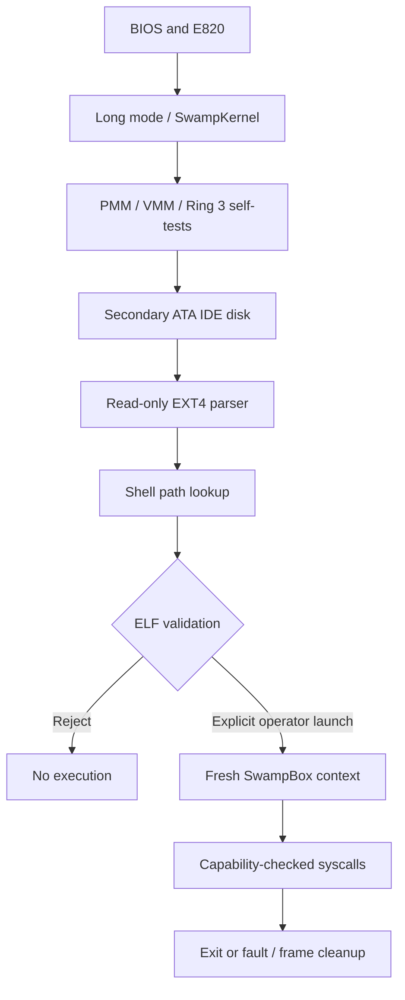
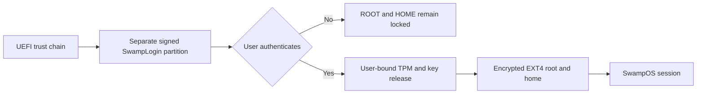

<div align="center">


[](RELEASE.md)
[](docs/ABI.md)
[](docs/STORAGE.md)
[](TEST-REPORT.md)
[](TEST-REPORT.md)

**A security-first operating system built from scratch.**  
No Linux kernel. No distribution remix. An independent experimental bare-metal OS.

[Quick start](#quick-start) · [Storage](#inside-vault) · [Native apps](#native-application-abi) · [Encryption](#swampvault--swamplogin) · [Security](#the-onion-security-model) · [Roadmap](#roadmap) · [Release](RELEASE.md)

</div>

## The swamp is yours.

SwampOS is a long-term project to build an independent OS with a custom kernel, mandatory application isolation, user-controlled device and network permissions, encrypted storage, verified boot, compatibility layers and a defensive software ecosystem. This milestone moves from built-in test payloads toward disk-backed native applications. It is not a production operating system, a usable desktop or a verified security product.

### Release telemetry / 0.6.0

| 128 MiB | 8 MiB | 4 KiB | 80,000 |
| :---: | :---: | :---: | :---: |
| Managed physical address ceiling | EXT4 development disk | Page size | Parser mutations across two clean tests |

| Signal | Actual evidence |
|---|---|
| Boot disk and kernel | Built and statically validated, guest unverified |
| Donkey scheduler | 2,000 native host test runs |
| PMM / VMM | 200,000 allocator churn iterations / 2,000 simulated address-space cycles |
| EXT4 + ELF | Actual kernel parser code, libext2fs-generated disk and 80,000 deterministic mutations under UBSan |
| RSA/AES prototype | Offline round-trip, bad password/key, tampering, truncation and no-output tests |
| Build reproducibility | Six compiled/disk artifacts compared across two clean builds |
| QEMU / real hardware | **Not run**; QEMU unavailable locally |

> [!IMPORTANT]
> The boot disk and EXT4 fixture are **plaintext**. The offline RSA/AES tool is not pre-boot authentication or full-disk encryption. No external app has been executed in guest Ring 3 during local validation. See [test evidence](TEST-REPORT.md) and [security boundaries](docs/SECURITY.md).

## Quick start

On Linux or WSL2 (GCC, GNU binutils, Make, Python 3, libext2fs development headers, Python cryptography, QEMU for guest execution):

```bash
./install.sh
make clean
make test       # host tests and static validation
make runtime    # mandatory guest gate, fails if QEMU is missing
make run        # interactive serial shell
```

The archive includes the compiled boot disk, separate EXT4 disk, ELF and hashes. Verify the bundled artifacts before rebuilding:

```bash
(cd build && sha256sum -c SHA256SUMS)
```

Boot the two disks in a disposable VM (the second disk uses a temporary overlay):

```bash
qemu-system-x86_64 -machine pc -cpu qemu64 -m 128M \
  -drive if=ide,index=0,format=raw,file=build/SwampOS.img \
  -drive if=ide,index=2,format=raw,file=build/vault.ext4,snapshot=on \
  -serial stdio
```

Never point this experimental kernel at a production disk. There is no physical-disk installer.

## Inside Vault




### Supported storage profile

| Property | Current implementation |
|---|---|
| Driver | ATA PIO LBA28, secondary master, bounded polling, IDENTIFY/read only |
| Block interface | 512-byte sectors, checked request size and capacity |
| Filesystem | Clean one-group EXT4, 4 KiB blocks, filetype + extents |
| Inodes | 128/256-byte inodes, regular files and directories only |
| Extents | Up to four inline extents, depth zero, no sparse/unwritten extents |
| Paths | Absolute paths, depth 8, bounded components, no symlinks or traversal |
| File size | Up to 64 KiB; console display limited to 4 KiB |
| Mutation | No write path, no journal replay, no metadata checksum support |

This is a constrained EXT4 reader, not general filesystem compatibility. The disk is generated using upstream libext2fs; the guest parser does not depend on that library. See [storage specification](docs/STORAGE.md).

### Console / operator reference

| Command | Purpose |
|---|---|
| `storage` | Show data disk status |
| `ls`, `ls /bin` | List directory entries |
| `cat /welcome.txt` | Read a file (sanitized display) |
| `fscheck` | Verify development fixture and ELF parsing |
| `run /bin/hello` | Launch without capabilities |
| `run-console /bin/hello` | Explicitly grant console for this run |
| `pmm`, `mem`, `vmtest`, `sandbox` | Memory, mappings and Ring 3 diagnostics |
| `tasks`, `ticks`, `selftest` | Cooperative tasks, timer, core tests |
| `help`, `status`, `version`, `clear`, `halt` | Console controls |
| `onion`, `shrek` | Essential swamp utilities |

Expected serial session, **illustrative only** (not a captured boot):

```text
VM_TEST_OK
USER_TEST_OK
CORE_TEST_OK
STORAGE_TEST_OK
SwampOS 0.6.0 Vault
Security has layers.
BOOT_OK

swamp> storage
EXT4 mounted: read-only, secondary IDE master, plaintext demo
swamp> cat /welcome.txt
SwampOS Vault: read-only EXT4 demo volume. NOT encrypted.
swamp> run /bin/hello
App result: 13
swamp> run-console /bin/hello
VAULT_APP_HELLO
App result: 0
```

## Native application ABI

`userspace/hello.S` is assembled and linked independently, written to `/bin/hello` on the EXT4 fixture and read by the kernel on explicit launch. It is not a built-in kernel payload. One static RX ELF64 load segment of up to 4096 bytes is allowed, mapped at `0x40000000`. The stack is RW/NX; the intervening guard page is absent. No writable program segment, dynamic linker, libc, arguments, file syscalls or concurrent user processes yet.


| `int 0x80` / RAX | Function | Permission |
|---|---|---|
| 0 | exit (RDI = status) | Always |
| 1 | write (RDI = pointer, RSI = length) | CAP_CONSOLE and bounded readable range |
| 2 | caps (return granted capability mask) | Always |
| Other | -ENOSYS | Denied |

See [ABI](docs/ABI.md). Default-deny launches are distinct from explicit grants. The kernel does not automatically execute programs found on the disk. Disk content has not been authenticated and guest enforcement is pending validation.

## SwampVault & SwampLogin

### Offline prototype (implemented, host only)

`tools/vault.py` uses RSA-4096 OAEP/SHA-256 and AES-256-GCM through Python cryptography. Each image receives a fresh AES key and nonce; the envelope header is authenticated. The RSA private key is password-protected PKCS#8. No plaintext output file is created before successful authentication. This is a whole-image envelope limited to 16 MiB, not transparent sector encryption or LUKS2.

```bash
python3 tools/vault.py keygen vault-private.pem vault-public.pem
python3 tools/vault.py seal build/vault.ext4 vault-public.pem demo.swvault
python3 tools/vault.py unlock demo.swvault vault-private.pem unlocked.ext4
```

Use a disposable test directory, never real data. No keys are shipped. Unlock produces a plaintext file; keep it and the private key out of Git. Python memory zeroization is not guaranteed. The envelope does not establish publisher identity or protect against rollback.

### Final protected boot architecture (required, not implemented)



| Partition | Target |
|---|---|
| EFI | Verified SwampBoot and authenticated multiboot registry |
| LOGIN | Separate signed offline pre-boot login, read-only normally |
| ROOT | EXT4 inside encrypted block device |
| HOME | Independently encrypted EXT4 user data |
| RECOVERY | Signed recovery, user-authenticated unlock only |

The target uses audited block encryption (AES-XTS plus validated integrity), RSA-OAEP key wrapping, Argon2id, TPM 2.0 user-bound release, signed recovery, anti-rollback and encrypted swap. No auto-unlock by TPM alone. See [Vault threat boundaries and target layout](docs/VAULT.md).

## The Onion Security Model

| Layer | Current state | Target |
|---|---|---|
| SwampKernel | Experimental PMM/VMM, IRQ, Ring 3 source | Rust/C/ASM hybrid, SMP, preemptive scheduling, hardened IPC |
| Donkey | Native host-tested cooperative tasks | Full process lifecycle |
| SwampBox / Onion | Fresh context, console-only capability | Mandatory per-app isolation, revocation, mediated devices, quotas |
| SwampFS | Read-only EXT4 subset | General VFS, file rights, write support |
| SwampBoot | BIOS bootstrap | UEFI Secure Boot, encrypted authenticated multiboot registry |
| SwampLogin / Vault | Offline host envelope only | Separate signed login partition, encrypted root and home |
| SwampWall / VPN | Design | Per-app network policy, split routing, DNS/IPv6 leak protection |
| SwampPKG | Design | Signed `.swp`, SBOM, rollback, DEB/RPM/EXE import and isolation |
| SwampCompute | Design | CUDA, ROCm, oneAPI, Vulkan, GPU mediation and isolated guests |
| SwampGUI | Design | Dark green desktop, operator controls, system and defence apps |

No production security claims. Existing kernel mappings have writable physical aliases; no SMEP/SMAP, DMA isolation, hardened interrupt stacks or cryptographically verified startup yet. See [security boundaries](docs/SECURITY.md).

## Five editions / one core

| Edition | Long-term focus |
|---|---|
| Desktop | Browser, office, media, files and daily use |
| Defence | Authorized network defence, forensics, audit and isolated lab tools |
| Developer | SDK, compilers, language runtimes, debugging and VM targets |
| Privacy | VPN, firewall, per-app routing, encrypted storage |
| Full | All four profiles in one shared secure core |

Profiles are metadata today, not separate usable images. Planned native `.swp`, Linux ABI/DEB/RPM, Win32/EXE via compatibility or isolated guests; driver ports from open-source systems with license preservation; GPU acceleration (CUDA/OptiX, ROCm/HIP, oneAPI, Vulkan); VPN protocol targets include Xray/sing-box, VLESS/REALITY, Hysteria2, WireGuard, OpenVPN and opt-in isolated validation of publicly shared configs. All previous architecture commitments remain in [ARCHITECTURE.md](docs/ARCHITECTURE.md).

## Repository map

```text
boot/           BIOS bootstrap + E820
kernel/         C and x86_64 assembly
  block.*       checked block interface
  ata.c         read-only legacy IDE driver
  ext4.*        bounded filesystem reader and path lookup
  elf.*         constrained external executable validator
  storage.*     integration and operator shell commands
  pmm.*, vm.*   physical and virtual memory
  policy.*, user*  capabilities and Ring 3
  task*, core.*    scheduler, timer, legacy allocators
userspace/      independent native application and linker script
tools/          libext2fs volume generator, offline encryption prototype
assets/         local SVG banners and architecture diagrams
docs/           architecture, ABI, security, storage, vault, testing
profiles/       five edition descriptors
legacy/         selected historical source and documentation
tests/          host, static and guest gates
build/          compiled disks, ELF, checksums and logs
.github/        CI workflow
```

## Roadmap

| Milestone | Evidence / state |
|---|---|
| 0.1 Genesis — custom bootstrap | Build delivered; guest unverified |
| 0.2 Onion — long mode | Build delivered; guest unverified |
| 0.3 Deep Onion — IRQs and basic memory | Build delivered; guest unverified |
| 0.4 Donkey — cooperative tasks | Host-tested |
| 0.5 SwampBox — PMM, paging, experimental Ring 3 | Host-tested; guest pending |
| **0.6 Vault — read-only storage, external ELF, offline cryptography** | **Current; host-tested, guest pending** |
| Next — runtime validation, process lifecycle, VFS | Planned |
| Protected boot — UEFI, separate login, encrypted volumes | Planned |
| Hardware — device drivers, IOMMU, GPU | Planned |
| Connectivity — network stack and VPN | Planned |
| Ecosystem — package system, compatibility, desktop, CUDA | Planned |
| Full — all profiles | Long-term target |

## Contributing & security

Small auditable patches. Preserve upstream licenses, report actual test scope, and do not claim security guarantees without validation. Project licensing is not finalized. No upstream driver source or proprietary GPU components are imported in this release. The host volume generator and crypto prototype link/use existing libraries; dependencies are not vendored.

[Security](docs/SECURITY.md) · [Testing](docs/TESTING.md) · [Changelog](CHANGELOG.md) · [Release notes](RELEASE.md)

<div align="center">

`root@swamp:~# security --layers`

**YOUR SYSTEM. YOUR RULES. YOUR SWAMP.**

</div>
