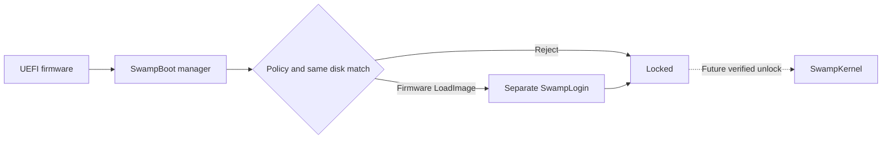

<div align="center">


[](RELEASE.md)
[](docs/ABI.md)
[](docs/BOOT.md)
[](TEST-REPORT.md)
[](TEST-REPORT.md)

**A security-first operating system built from scratch.**  
No Linux kernel. No distribution remix. An independent experimental bare-metal OS.

[Quick start](#quick-start) · [Boot chain](#inside-swampboot) · [Crypto](#offline-encryption--multiboot) · [Kernel](#kernel--native-apps) · [Roadmap](#roadmap) · [Release](RELEASE.md)

</div>

## `> whoami`

SwampOS is a long-term project to create an independent, security-first operating system with mandatory application sandboxes, user-controlled device and network permissions, encrypted storage, verified boot, cross-platform compatibility, and a native defensive software ecosystem. SwampBoot separates the pre-boot environment from the kernel and lays out the future encrypted system on GPT. It is an experimental engineering build, not a production security product.

| x86_64 | 5 | 10 | 166 MiB |
| :---: | :---: | :---: | :---: |
| Architecture | GPT partitions | Reproducible artifacts | Lab GPT image |

> [!IMPORTANT]
> **Firmware execution is unverified.** The default UEFI image is unsigned and uses the lab manager. SwampLogin displays LOCKED and accepts no credentials. It never unlocks a disk or boots the kernel. The independent BIOS/EXT4 demo is plaintext. Do not install on real disks or store sensitive data. See [security boundaries](docs/SECURITY.md).

## Quick start

Linux / WSL2, GCC, GNU binutils, Clang, LLD, Python 3, libext2fs, cryptography, QEMU and OVMF:

```bash
./install.sh
make clean
make -j2 test       # host tests + static validation
make runtime         # BIOS guest gate (QEMU required)
make uefi-runtime    # UEFI guest gate (QEMU + OVMF required)
make run             # independent BIOS/EXT4 lab console
```

Verify the supplied compiled images and firmware executables:

```bash
(cd build && sha256sum -c SHA256SUMS)
```

Boot the separate UEFI lab image in a disposable VM (OVMF path varies by distro):

```bash
qemu-system-x86_64 -machine q35 -m 256M \
  -bios /usr/share/OVMF/OVMF_CODE_4M.fd \
  -drive format=raw,file=build/SwampBoot-GPT.img,snapshot=on \
  -nographic -monitor none
```

This path is designed to stop locked; it is **not** a UEFI boot of SwampKernel. The existing BIOS `make run` uses its own 1 MiB boot disk plus 8 MiB secondary EXT4 demo volume.

## Inside SwampBoot




| Build | Meaning |
|---|---|
| `BOOTX64.EFI` | Unsigned strict-policy application; checks SecureBoot and SetupMode |
| `BOOTLAB.EFI` | Explicit lab application; permitted on non-secure firmware |
| `LOGIN.EFI` | Separate fail-closed login application, no authentication backend |
| `SwampBoot-GPT.img` | Lab manager + login, root/home/recovery empty |

The manager uses firmware protocols to resolve exactly one matching login partition on the same disk, constructs a file device path and delegates image loading to firmware. No fallback to arbitrary disks and no kernel handoff. Both EFI builds contain relocation information. The fixed lab GUIDs are not secure device identities.

### GPT partition map

| Name | Capacity | Format / content |
|---|---:|---|
| SWAMPBOOT | 64 MiB | FAT32 ESP |
| SWAMPLOGIN | 64 MiB | Separate FAT32 partition |
| SWAMPROOT | 17 MiB | Empty or offline encrypted image envelope |
| SWAMPHOME | 17 MiB | Empty or offline encrypted image envelope |
| SWAMPRECOVERY | 2 MiB | Reserved |

Primary and backup GPT CRC32 checks, protective MBR, bounded partition parsing and overlap checks. CRCs do not authenticate disk contents. See [BOOT.md](docs/BOOT.md).

## Offline encryption & multiboot

The Vault tools remain independent from native firmware. RSA-4096 OAEP wraps an AES-256-GCM content key; encrypted private keys are password-protected PKCS#8. The new registry adds Ed25519 signatures over the ciphertext and generation metadata, validates the schema, verifies before decrypting and checks an externally supplied rollback floor. It does not yet verify actual loader binaries, use TPM counters, or drive firmware menus.

```bash
python3 tools/vault.py keygen vault-private.pem vault-public.pem
python3 tools/vault.py seal build/vault.ext4 vault-public.pem root.swvault
python3 tools/gptdisk.py encrypted-lab.img build/BOOTLAB.EFI build/LOGIN.EFI \
  --root-envelope root.swvault
python3 tools/boot_registry.py keygen signing-private.pem signing-public.pem
python3 tools/boot_registry.py seal config/registry-example.json vault-public.pem \
  signing-private.pem boot.swreg
python3 tools/boot_registry.py verify boot.swreg vault-private.pem \
  signing-public.pem --floor 1
```

The example registry hash is deliberately a placeholder, not a measured bootloader. Replace it with actual SHA-256 before using it as metadata. Provisioning only checks envelope shape; use the host unlock command to authenticate a ciphertext. Do not ship passwords/private keys. Offline tool output is not transparent full-disk encryption; native login, TPM and block encryption remain open gates.

## Kernel & native apps


The existing BIOS kernel retains E820-aware PMM (128 MiB physical ceiling), 4 KiB paging, separate user roots, W^X/NX mappings, Ring 3 test programs, capability-checked syscalls, watchdog, cooperative tasks, read-only ATA/EXT4 and bounded native ELF64 execution. New `pci` scans legacy PCI config-space and `gpt` validates the secondary IDE disk partition table. These hardware paths remain guest-unverified.

| Command | Purpose |
|---|---|
| `help`, `version`, `status`, `ticks` | Console and diagnostics |
| `pmm`, `mem`, `vmtest`, `selftest` | Memory and core self-tests |
| `sandbox`, `tasks` | Isolated test context / cooperative task demo |
| `storage`, `fscheck`, `ls`, `cat` | EXT4 demo |
| `run /bin/hello` | Launch with no console capability |
| `run-console /bin/hello` | Explicit console capability grant |
| `pci`, `gpt` | Read-only hardware inventory / partition validation |
| `onion`, `shrek`, `clear`, `halt` | Swamp utilities |

The shell is serial-driven; these commands are source-level features, not a captured guest session. See [ABI](docs/ABI.md), [storage](docs/STORAGE.md) and [Vault](docs/VAULT.md).

## Validation / evidence

| Test category | Across two clean builds |
|---|---:|
| PMM churn / VMM cycles | 200,000 / 2,000 |
| Native host scheduler | 2,000 runs |
| EXT4 + ELF mutations | 80,000 |
| GPT mutations | 12,000 |
| EFI policy mock cases | 28,000 |
| Device-path mutations | 40,000 |
| Login mock calls | 2,000 |
| PCI enumeration full / early-stop | 2,000 / 2,000 |
| Registry byte mutations | 1,686 |
| Reproducible build artifacts | 10 / 10 |

The final RSA/AES test of the second suite was rerun separately after a tool timeout and passed. Host tests and mocked firmware are **not** proof of guest CPU execution or production-grade isolation. Both runtime gates were attempted and could not run because QEMU/OVMF are unavailable locally. [Full test report](TEST-REPORT.md) · [first log](build/test-first.log) · [second log](build/test.log).

## Roadmap

| Layer | State |
|---|---|
| Genesis / BIOS bootstrap | Compiled, guest unverified |
| Onion / memory / IRQ | Experimental, host-validated components |
| Donkey / scheduler | Cooperative host-tested |
| SwampBox / capabilities | Experimental Ring 3 path |
| Vault / EXT4 + ELF | Constrained read-only, host-tested |
| SwampBoot / GPT + UEFI | Compiled, mocked firmware; locked login |
| SwampLogin / real encrypted unlock | Not implemented |
| Hardware / ACPI, USB, NVMe, GPU | PCI inventory only |
| Connectivity / SwampVPN, SwampWall | Planned: VLESS, Hysteria2, WireGuard, per-app routing |
| SwampPKG / SwampUnix / SwampWin | Planned: SWP, DEB, RPM, ELF/Win32 compatibility |
| SwampCompute | Planned: CUDA, ROCm, oneAPI, Vulkan, GPU mediation |
| SwampGUI / SDK / apps | Planned native desktop, defensive and developer tools |
| Full Edition | Long-term target |

Five edition manifests remain in `profiles/`: Desktop, Defence, Developer, Privacy and Full. They are specifications, not independently bootable distributions. [Full architecture](docs/ARCHITECTURE.md) retains the complete target including mandatory sandbox, encrypted EXT4, protected multiboot, open-source driver ports, multi-language SDK, VPN and CUDA support.

## Repository map

```text
boot/uefi/    firmware manager and separate login
kernel/       independent BIOS kernel, PMM/VMM, GPT, PCI, storage
userspace/    native ELF fixture
 tools/       offline registry, GPT generator, Vault and EXT4 tooling
 tests/       host, mutation and guest gates
 assets/      local SVG branding and diagrams
 docs/        architecture, ABI, security, storage and boot docs
 profiles/    five future editions
 legacy/      retained historical materials
 build/       reproducible binaries, disk images and test logs
```

License selection remains pending; no blanket license claim is made. No upstream driver code imported in this release. Contributions should include evidence, not just status labels.

<div align="center">

**SECURITY HAS LAYERS. THE FIRST IS TRUST.**

`YOUR SYSTEM. YOUR RULES. YOUR SWAMP.`

</div>
